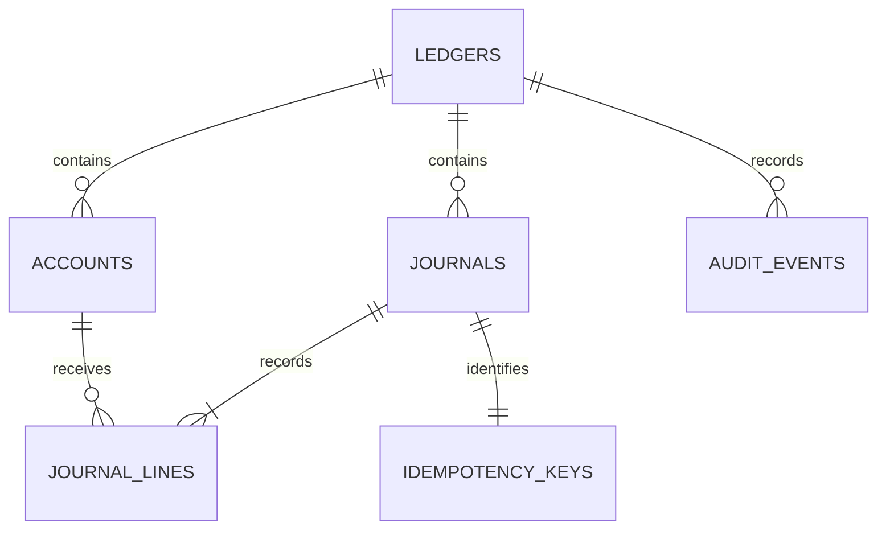

# Architecture

## Boundary and data model

The service is a Go modular monolith. Chi handles HTTP, the auth package verifies tokens, pure ledger types validate posting rules, and the ledger store owns pgx transaction boundaries. sqlc generates the currency reference queries. Lock-sensitive financial SQL remains explicit in the store so lock acquisition and visibility are reviewable together.

Each account has an immutable type, currency, code, and negative-balance policy. Its only mutable field is `closed`. Closure requires a zero net balance, checked after acquiring the same account row lock used by postings. PostgreSQL also rejects nonzero-balance closure through a trigger. Every journal is posted in its creation transaction. There is no persisted draft state and no balance column. Journals have server-assigned timestamps; backdating is outside the MVP. Every journal line references a journal and an account through composite ledger/currency foreign keys.

## Posting transaction

1. Compute a SHA-256 fingerprint of the normalized typed payload, operation, and reversal target.
2. Start a READ COMMITTED transaction and acquire a transaction advisory lock on the ledger/key pair. Hash collisions can serialize unrelated requests but cannot merge their stored identity.
3. Look up the durable key. Matching requests return the stored journal; mismatches fail with 409.
4. For a reversal, load the original and derive exact opposite lines. Reject reversal-of-reversal.
5. Validate positive minor units, 2–100 unique account lines, and balanced int64 totals.
6. Lock all affected accounts in ascending UUID order. Check their ledger, currency, closed state, and negative-balance policy. Each balance check runs after its account lock has been acquired and sees earlier committed postings.
7. Insert the journal, all lines, idempotency result, and audit event.
8. Commit. Deferred database constraints validate the completed journal and reject the entire transaction if invalid.

A five-second lock timeout bounds contention. The HTTP context has a ten-second database deadline. Serialization, deadlock, lock-timeout, and state conflicts return 409; clients can retry the same payload/key. The service does not retry internally after an uncertain commit; the durable key resolves an ambiguous response.

## Database enforcement

- Positive bigint amounts and allowed debit/credit sides.
- Composite foreign keys enforce ledger and currency boundaries.
- Deferred constraint triggers on journal creation and line insertion require at least two lines, nonzero equal side totals, and totals within signed 64-bit limits. Later line inserts queue fresh validation even if `SET CONSTRAINTS` already flushed earlier events. The same validator enforces exact reversal and nonnegative policies.
- Journal and line UPDATE/DELETE are rejected. Lines can only be inserted into journals created in the same transaction, using a full transaction ID (`xid8`). Later append is rejected.
- Reversals have a unique original reference, match the original currency/ledger, and must exactly invert the original lines at commit.
- Line insertion locks the account and rejects closed accounts. Deferred validation also checks nonnegative policies.
- Audit records cannot be updated or deleted through ordinary DML.

Application account locks provide the supported concurrency protocol. Direct bulk import SQL must follow the same ascending account lock order and READ COMMITTED isolation; bypassing the service is not a supported write API. Database owners/superusers can disable triggers or truncate data, so production role separation is required.

## Money and reports

Names, codes, and descriptions count Unicode code points to match PostgreSQL text length and OpenAPI maxLength. Opaque idempotency keys remain limited to 128 bytes.

All request amounts are decimal strings of integer minor units. Floats, exponent notation, leading plus signs, and leading zeros are rejected. Currency metadata defines precision for display; AED/PHP/USD use two decimal places. There is no FX conversion or multi-currency journal.

Natural balances are debit-normal for assets/expenses and credit-normal for liabilities/equity/income. Per-account sums use PostgreSQL `numeric` to avoid aggregate overflow. Trial balance returns debit/credit totals for every account ordered by currency and code; clients must compare totals within each currency. Individual report queries use committed database snapshots. Separate report requests may observe different commits.

Offset pagination is bounded, stable for a fixed dataset, and suitable for this portfolio scale. It is not a consistent multi-page snapshot under concurrent writes. Large exports and account volumes should add snapshot/cursor reporting before production growth.

## Authorization and operations

Financial routes verify HS256 signatures and required subject, issuer, audience, issue time, and expiration claims, and honor not-before when supplied. Tokens last at most one hour. Ledger claims assign reader/writer/admin roles. Global operator tokens can create ledgers and bootstrap scoped access. Authorization runs before resource access; indirect account/journal references remain ledger-scoped in SQL.

An offline token command supports the demonstration. Password authentication, user signup, an identity-provider integration, token revocation, and signing-key rotation with overlapping key IDs are outside this release. Operators can rotate the shared signing secret to invalidate every existing token.

Goose migrations are embedded in a standalone command and acquire a PostgreSQL session advisory lock. Compose runs migration completion before starting the API. The API supports graceful shutdown, structured error logs, request IDs, request body/header limits, bounded database contexts, and process/database health checks.

## Release scope and remaining risks

The MVP includes accounts, posting, transfers, reversals, idempotency, scoped authorization, audit history, statements, and trial balance. PostgreSQL integration tests cover concurrent retries, overdraft prevention, opposing transfers, database constraints, fault injection, and the HTTP workflow.

FX, Redis, queues, external settlement, accounting periods, scheduled entries, and SaaS tenancy administration remain deferred. Operational requirements before live use include reviewed database grants, restore drills, TLS, central logging/metrics, ingress rate limits, identity management, and accountant review of business-specific posting rules. Backups must include idempotency and audit data to preserve retry semantics after recovery.
